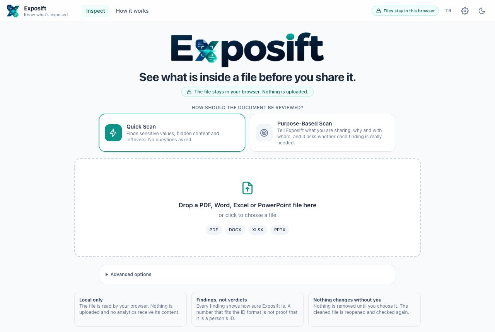
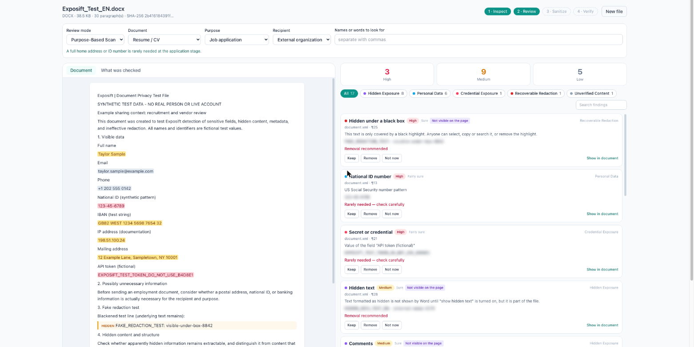
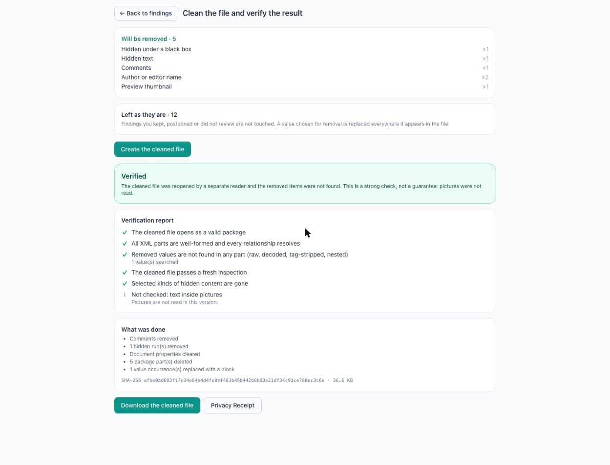
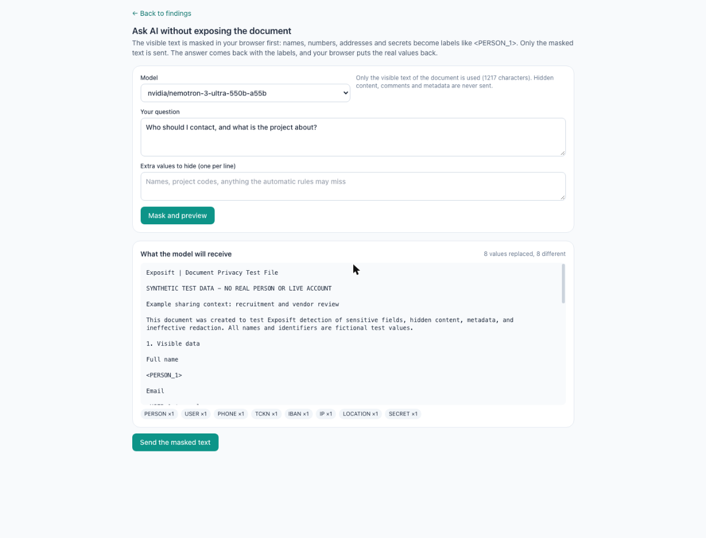
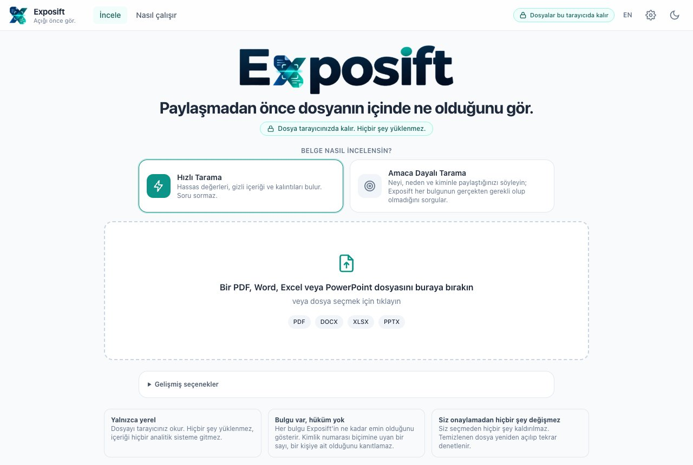

<p align="center"></p>

# Exposift

**See what is inside a PDF, Word, Excel or PowerPoint file before you share it: find sensitive values and hidden content, remove what you choose, and check the result.**

**[Try the live demo](https://spaksu.github.io/exposift/)**: no sign-up; your file is opened and cleaned in your browser and never uploaded. The settings screen works too (rules, categories, backup and change log are kept only in your browser; **Reset demo** clears them). The AI features and the admin password need a server and are switched off in the demo.

> **Expos(e)** + **sift**: sift through a file for what it exposes. **Inspect → Review → Clean → Verify.** Nothing is removed until you choose it, and the cleaned file is re-opened with a separate reader to check that it is really gone.



The interface is **English by default** with a **Turkish** option (one click in the top bar).

---

## Screenshots

> The documents in the screenshots are **made-up sample files** (`tests/corpus/`).

### Findings

Every finding says where it is, why it matters and how sure Exposift is. You decide: remove, keep or decide later. A purpose-based scan also asks whether each value is really needed for what you are sharing.



### Cleaned and verified

The result is re-opened with a different reader and searched again. A **Privacy Receipt** (JSON) records what was done, with hashes and never the sensitive values.



### Ask AI without exposing the file

Only masked text (`<PERSON_1>`, `<IBAN_1>` …) goes to the model; the real values are put back in your browser. The model can also propose rewrites of Word, Excel and PowerPoint text, which you review before downloading.



### Turkish interface



---

## Features

### What it finds
- **Visible values:** names, e-mail addresses, phone numbers, national IDs (TCKN, SSN), IBANs, cards, IPs, URLs, secrets and keys.
- **Hidden content:** comments, tracked changes, hidden text, sheets, rows and slides, speaker notes, metadata, embedded files, thumbnails, custom XML, external links, earlier versions inside a PDF.
- **Ineffective redaction:** black boxes drawn over text that is still extractable.
- **Text in pictures:** on request, read with OCR in the browser (local Tesseract.js, English and Turkish).
- **Quick scan** or **purpose-based scan** (you say what you share, why and with whom).

### How it cleans
| File | Method |
|---|---|
| DOCX / XLSX / PPTX | The XML parts are edited directly: comments, tracked changes, hidden and white text, properties, embedded files and thumbnails removed; a chosen value is replaced everywhere, even when split across runs. |
| PDF, structure only | Rebuilt without metadata, notes, attachments, scripts, bookmarks and earlier versions. |
| PDF, **redact text** | The characters of chosen values are taken out of the page content (not just covered) and a black box is drawn; text search and copying keep working. |
| PDF, **flatten & rebuild** | Automatic fallback when the text cannot be removed reliably: every page becomes a picture, chosen values covered first. |

### Verification
Opens the result with a different reader and searches raw streams, decoded text, metadata, notes and attachments for the removed values. The report says what was checked and what was not.

### AI (optional)
- **Ask a question** about the document, or **rewrite the file** (fix spelling, change tone, translate).
- **NVIDIA API**, **OpenAI-compatible** and **Ollama** connections; API keys stay on the server.
- Hidden content, comments and metadata are never sent. Without a connection Exposift works fully offline.

### Administration
- Settings screen with the masking rules and categories used for AI, AI connections, backup / export, import and a change log.
- User guide (`guide.php`) and administrator guide (`admin-guide.php`) in English and Turkish.

---

## Requirements

- PHP 8.1+ (`mbstring`, `curl`)
- Apache (`.htaccess` blocks access to `config.php`, `src/`, `partials/`, `guides/` and `lang/`)
- **No database.** Settings are kept in `data/settings.json`, so `data/` must be writable.

No internet connection is needed: PDF.js, pdf-lib, fflate, Tailwind and Tesseract.js (with English and Turkish data) ship with the repository; no CDN is used.

## Installation

There is no setup wizard and no Composer.

1. Copy the repository under your web server:
   ```bash
   git clone https://github.com/Spaksu/exposift.git
   ```
2. Open the app in your browser. That is all that is needed to inspect and clean files.
3. To use the AI features, open ⚙️ **Settings** at the top right, set the administrator password (at least 8 characters) and add a connection under **AI connections**. Alternatively, copy `config.example.php` to `config.php` and enter the connection there. The app ships without any key.

## Pages

| Page | Description |
|---|---|
| `index.php` | Inspect, review, clean and verify a file |
| `settings.php` | Masking rules, AI connections, backup, change log (login required) |
| `guide.php` | User guide |
| `admin-guide.php` | Administrator guide |

## Project structure

```text
├── index.php               Main screen
├── api.php                 JSON API (settings, AI relay)
├── settings.php            Administration
├── guide.php, admin-guide.php
├── config.example.php      Sample configuration
├── src/
│   ├── Llm.php             NVIDIA / OpenAI-compatible / Ollama client
│   ├── Settings.php, Auth.php
│   ├── I18n.php            Translation helper t()
│   └── bootstrap.php
├── lang/tr/                Turkish translations ([English => Turkish] arrays)
├── guides/                 Guide texts per language
├── partials/               Shared layout and guide helpers
├── tests/                  Test runner and sample files
├── demo/build.php          Static GitHub Pages build
└── assets/
    ├── js/                 app, ai, ocr, settings scripts
    │   ├── core/           detection, analysis, plan
    │   └── adapters/       pdf, docx, xlsx, pptx readers, sanitizers, redaction, transform
    ├── css/app.css
    └── vendor/             PDF.js, pdf-lib, fflate, Tesseract.js (+ language data)
```

## Adding a language

Source strings are English. To add a language, create `lang/<code>/*.php` files that return `['English text' => 'Translation']` arrays and add the code to `I18n::LANGS` in `src/I18n.php`. PHP uses `t()`, JavaScript uses `Ex.t()`; placeholders look like `{name}`.

## Live demo

The demo renders the app's own pages on GitHub Pages and works entirely in the browser, so nothing is uploaded. The settings screen runs for real: rules, categories, scan mapping, backup and the change log live in each visitor's own browser until they press **Reset demo**. AI connections can be added to try the screen, but they are kept without keys and never used; the AI features and the admin password need a server and are switched off.

On every push, the tests run and the site is rebuilt and published.

```bash
php demo/build.php        # build the static site into _site/
```

### Tests (development only)

The tests need Node.js with a few packages; the app itself does not.

```bash
npm install fflate@0.8.2 pdf-lib@1.17.1 pdfjs-dist@4.10.38 @xmldom/xmldom@0.9.12
EXPOSIFT_NM=$PWD/node_modules node tests/run-tests.mjs
php tests/auth-test.php
```

## Security notes

- Exposift reduces risk; it does **not** guarantee that a file is safe to share. Look at the result before you send it.
- Findings are evidence, not verdicts. A number shaped like an ID does not prove that it belongs to a person.
- Not supported: password-protected files, legacy `.doc` / `.xls` / `.ppt`, pivot-table caches, macro removal, text inside pictures in Office files (replace the picture). OCR can be wrong.
- Rewrites are checked by re-opening the file; check them in Word, Excel or PowerPoint before sharing.
- `config.php` and `data/settings.json` are not committed (`.gitignore`) and are blocked from web access by `.htaccess`.
- The administrator password is stored with `password_hash`; API keys stay on the server and are not included in exports.
- A content security policy lets the page talk only to its own server. No analytics, no external fonts or CDNs.

## License

Copyright © 2026 Spaksu. Exposift is released under the [MIT License](LICENSE). Bundled third-party components (PDF.js, pdf-lib, fflate, Tailwind CSS and Tesseract.js in `assets/`) remain under their own licenses; see [NOTICE](NOTICE).
